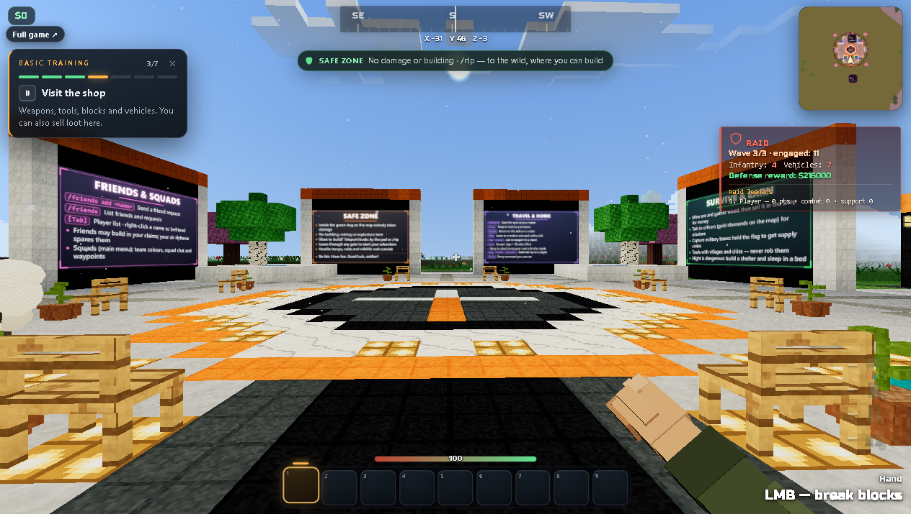

# VOXEL RUSH — offline mirror

Full mirror of **VOXEL RUSH** (https://play.voxelrush.app/) — "Free Browser FPS
with Tanks, Helicopters & Drones".

Source: https://play.voxelrush.app/



## Stack

- **Vite production build** served at the origin root by Cloudflare — the entry
  chunk `assets/index-Dp6GxvJu.js` (2,965,190 B) carries the app plus a bundled
  **three.js r169** core (content-anchored wholeFile region, never sliced)
- **the world runs in workers** — `assets/local-server-worker-coep-v1-*.js`
  (3,714,882 B) is the offline world server; it dynamic-imports the obfuscated
  payload chain `./bootstrap-C4umvuQD.js` → `./main-Bs7z9e_r.js` →
  `./terrain-pool-Dvsi82A-.js` and serves its world data (`/world/*`,
  `/structures/*`, map JSON) from memory — that in-memory world is what makes
  Single player work with no backend
- **cross-origin isolation required** — the origin sends
  `cross-origin-opener-policy: same-origin` +
  `cross-origin-embedder-policy: require-corp` (SharedArrayBuffer for the
  worker world); `tools/serve.mjs` sends the same headers, a plain static
  server will not boot the world
- **obfuscator.io-protected payloads** — the four worker/module chunks and
  `sw.js` are control-flow-flattened with base64 string tables; app and engine
  strings (including the module names above) live in those tables
- **off-origin references stay external** — `telegram.org/js/telegram-web-app.js`,
  the Discord invite and the `voxelrush.app` marketing pages are recorded in
  `_mirror-report.json`, never backfilled

## What this is

VOXEL RUSH (play.voxelrush.app) — "Free Browser FPS with Tanks, Helicopters &
Drones": 40-soldier battles for five flags with tanks, helicopters, FPV drones
and mines, Team Deathmatch, plus a voxel survival sandbox ("Your own world,
offline"). The client is a Vite production build whose entry chunk carries
three.js r169 inline; the offline world is simulated by the local-server worker
and rendered with a mesh worker. Captured whole, byte-exact under
`.upstream/manifest.json`: **47 files, 14,715,503 bytes** — the entry document
(163,277 B), the entry chunk + stylesheet (346,768 B), four worker/module
payloads, the service worker, 22 dealer-bank WAVs (en/ru), 10 images and the
`/about/` + `/ru/` static pages plus manifest/version/sitemap/robots. The
runtime graph was driven to a fixpoint by `tools/capture.mjs`; the
`bootstrap/main/terrain-pool` payloads were found by playing the served mirror
in a browser — the boot test failed on exactly that worker import, and decoding
the obfuscated string tables then enumerated the chain (see the derivation
note).

Live backend (stays external — not part of the capture): online play and
account features talk to `backend.voxelrush.app`; served locally the menu shows
"Account unavailable" and online play cannot join, while Single player runs
fully from the capture. The origin answers missing paths with an HTTP 200
text/html SPA-index fallback, so the capture tool rejects any non-HTML response
that is actually the index — recorded in the report as fallback gaps, never
captured as files.

## Layout

- `index.html` + `about/` + `ru/` + `assets/` + `sw.js` + `manifest.webmanifest`
  + `version.json` + `sitemap.xml` + `robots.txt` — the capture at the origin
  root (served paths = on-disk paths; directory routes at their trailing slash)
- `.upstream/manifest.json` — sha256 + bytes for every captured file (Gen-A)
- `_mirror-report.json` — crawl record: request count, fetched paths, recorded
  gaps (404s and SPA-fallback paths), external references
- `readable/` — prettified derived layer (pinned prettier 3.9.6): 9
  `*.pretty.js` + 6 `*.pretty.css` + `index-inline-map.json`
- `src/` + `split-spec.json` — 682 statement-aligned slices with the recorded
  derivation spec (695 sections)
- `docs/cover.png` — gameplay cover; `docs/boot-2026-10-13.png` — boot evidence;
  `docs/boot-harness.html` — the iframe boot harness (embed mode is a supported
  mode of the app; the capture is untouched)
- `tools/capture.mjs` — byte-exact capture + runtime-closure fetch (`--check`
  for a residual closure audit)
- `tools/derive.mjs` — rebuild `readable/` + `src/` + `split-spec.json`
- `tools/verify.mjs` — re-hash the capture against the manifest
- `tools/update.mjs` — read-only drift probe against the live origin
- `tools/audit.js` — integrity gate for the derived layers (`AUDIT PASS`)
- `tools/serve.mjs` — local static server with the origin's COOP/COEP headers
  (directory-index aware; boot/play only)

## Assets

- **audio** — 22 file(s): `assets/` (the dealer voice bank, en + ru: betting,
  blackjack, bust, deal, dealer, lose, push, result, turn, welcome, win)
- **images** — 10 file(s): `screens/` (4 gameplay screenshots:
  frontline-river-crossing / frontline-village-fight / frontline-kavir-citadel /
  deploy-classes), `icons/` (4 app icons incl. maskable-512), `og-image.jpg`,
  `favicon.ico`
- **data** — 4 file(s): `manifest.webmanifest`, `version.json`, `sitemap.xml`,
  `robots.txt`
- **fonts** — none as files (the UI font ships base64-inlined in the entry/CSS)
- **models** — none as files (the voxel world is generated by the workers; meshes
  are built procedurally)

## Run

```
node tools/serve.mjs 8099       # serves the repo root on loopback
```

then open http://127.0.0.1:8099/ — the origin requires cross-origin isolation
(COOP same-origin + COEP require-corp), which `tools/serve.mjs` reproduces; a
plain static server without those headers boots the menu but the world worker
will fail. Single player ("Your own world, offline") works fully from the
capture; online play needs the live `backend.voxelrush.app`. For automated
screenshots the mirror was played through `docs/boot-harness.html` — the app is
a first-class embed target and switches to pointer-lock-free drag-look when
framed (the harness loads only captured files and modifies nothing).

## Verify

```
node tools/verify.mjs            # re-hash the capture against the manifest
node tools/audit.js              # derived-layer integrity gate → AUDIT PASS
node tools/capture.mjs --check   # residual closure audit → 0 new unresolved
```

## Updating from upstream

```
node tools/update.mjs            # read-only drift probe: what changed upstream
```

The probe never rewrites the capture — a mirror is a point-in-time snapshot.
The origin serves an HTTP 200 text/html SPA fallback for missing paths, so the
probe only trusts a 200 whose content type matches the file (an HTML page whose
bytes equal the entry document counts as live-missing); directory captures
(`about/index.html`, `ru/index.html`) are probed at their trailing-slash
routes. Refreshing means re-fetching into a clean tree
(`node tools/capture.mjs`), re-cutting the manifest, and re-deriving
`readable/` + `src/` from the new bundle with `node tools/derive.mjs`. A real
refresh must move the replaced files to `legacy/<date>/` first (PLAN §3).

### 2026-10-13 capture + readable/src derivation

- **Capture** (byte-exact, nothing edited): 47 files, 14,715,503 bytes. Cloudflare
  served the build `mv5sawna-jtl2ka` (`version.json`, built 2026-10-12T21:49Z);
  the recon entry copy (`index-zrKzzARX.js`) is stale — the live redeploy served
  `index-Dp6GxvJu.js`, which is what this capture carries. The origin answers
  missing paths with an HTTP 200 text/html SPA fallback; the capture tool rejects
  that fallback, so the report records 101 gap entries (the 22 build-time
  `assets/dealer/*.wav` key names whose hash-suffixed files ARE captured, 43
  serialized-world key names from the local-server worker's object table, the
  in-memory `/world/*` + `/structures/*` routes, and dev-only literals such as
  `scripts/build-about-pages.mjs` and `voxel-rush-skin.png` — all found by the
  static scan, none served as files upstream).
- **Closure cross-check (the boot test found a real gap)**: serving the first
  capture and playing it, the world boot died on
  `GET /assets/bootstrap-C4umvuQD.js` — the worker dynamic-imports it from a
  base64-encoded string table, invisible to the literal scanner. Decoding the
  obfuscated string arrays enumerated the whole chain
  (`bootstrap-C4umvuQD.js` → `main-Bs7z9e_r.js` → `terrain-pool-Dvsi82A-.js`),
  the three files were fetched, and the mirror then loaded the world with zero
  404s. `tools/capture.mjs --check` → `138 reference group(s), 62 unresolved
  (0 new vs _mirror-report.json), 6 external off-origin reference(s)`; the
  played local session requested only captured same-origin paths (plus the boot
  harness page itself).
- **readable/** — pinned prettier 3.9.6 (module API, default options, formatted
  to a layout fixed point, 1–2 passes — never the CLI, it respects `.gitignore`
  and can silently echo its input) rendered 7 captured JS files to
  `readable/<name>.pretty.js` (nested dirs flattened with `__`; largest:
  `assets__main-Bs7z9e_r.pretty.js`, 144,271 lines; the entry chunk
  `assets__index-Dp6GxvJu.pretty.js`, 139,080 lines) and the stylesheet to
  `readable/assets__index-D16eXMZ8.pretty.css` (20,802 lines). Every pretty is
  provably not a byte copy of its capture source and re-renders byte-exact
  under the pinned version (15/15).
- **Vendor region — wholeFile, never sliced**: inside the entry chunk, the
  bundled **three.js r169** core is content-anchored — from the WebGL
  constants/revision declaration carrying the Three.js Authors MIT license
  header through the `window.__THREE__` revision registration — and the Vite
  modulepreload/helper prefix before it is wholeFile machinery too
  (lines 1–36 machinery, 37–25,942 three.js of the 139,080-line pretty), both
  with positive + negative guards asserted in `derive.mjs` and re-checked by
  `audit.js`. Divergence recorded: the obfuscated payloads also embed three.js
  (math/renderer strings inside the string tables), but obfuscator.io flattens
  those statements and base64-encodes the strings, so no stable anchors exist —
  they are derived as app code and stay obfuscated (rename campaign open).
- **src/** — 682 statement-aligned slices (`src/<tag>-NN.js`, exact 2-line
  provenance header) across the 7 chunks, recorded in `split-spec.json` (695
  sections): 682/682 parse standalone (`node --input-type=module --check -`)
  and round-trip byte-exact to their readable line ranges. Cuts land only on
  top-level declaration boundaries (~250–350 line windows); oversized single
  declarations stay whole (the string tables and flattened IIFEs in the
  obfuscated payloads). Non-standalone parts are skipped sections, indexed but
  never sliced (3: the chunks' final `export {…}` tables).
- **Inline blocks** — `index.html` carries a boot `<script>`, three `<style>`
  blocks and a closing storage-cleanup `<script>`; `about/index.html` and
  `ru/index.html` each carry one `<style>`. All 7 content blocks get wholeFile
  twins + `readable/index-inline-map.json` (exact byte ranges + sha256); the 3
  `application/ld+json` data blocks are hashed notRendered records (no pretty
  pass). The off-origin `<script src="https://telegram.org/js/telegram-web-app.js">`
  is not derived (external — never captured).
- **notRendered** — 39 hashed records (22 audio, 10 images, 4 data files, 3
  inline-data blocks; bytes + sha256, no pretty pass).
- **Gates**: `node tools/verify.mjs` → `47 files checked, 0 problems`;
  `node tools/audit.js` → `AUDIT PASS — 695 spec sections (682/682 src↔pretty
  round-trips byte-exact, 15/15 pretty sources tiled contiguously, 3/3 skipped
  sections re-verified, 682/682 src slices + 9/9 readable pretties parse
  standalone, 15/15 pretties provably distinct AND re-render byte-exact,
  7 inline blocks with twins, 3 inline data blocks recorded, 7/7 imports
  resolved-or-whitelisted)`; `node tools/capture.mjs --check` → 0 new
  unresolved. Independent 3-slice round-trip check → 3/3 byte-exact. Boot test:
  mirror served on loopback, opened through opencli — the menu rendered
  (`docs/boot-2026-10-13.png`), single player built the world and entered play,
  and the cover shows live gameplay (`docs/cover.png`: first-person voxel base
  plaza, HUD, hotbar, minimap, active raid panel). Serve probe: `node
  tools/serve.mjs` on loopback, entry + entry chunk + stylesheet + `about/` over
  HTTP 200 at their recorded sizes, listener PID killed, port proven closed
  (`netstat`).
- **§0.4 fork-over-mirror checked 2026-10-13**: no public upstream source repo —
  the capture contains zero `github.com`/`gitlab.com` references; the only
  off-origin URLs are telegram.org, discord.gg, the `voxelrush.app` marketing
  domain and schema.org/w3.org namespaces inside the ld+json blocks, so the
  mirror stands.
- **Open tasks (PLAN §5)**: identifiers in `src/` — including the whole
  obfuscated payload chain — are the bundle's own (mangled) names; the deep
  identifier-rename campaign is not done and is not claimed here. The
  obfuscated string tables themselves are currently readable only by running
  the same decode pass used during capture (documented above); a checked-in
  decoded table for the four payloads would be a future derived artifact.
  Rebuild the derived layers any time with `node tools/derive.mjs`.

## Mirror conventions

- **Capture layer** — the captured files are byte-exact copies of what the
  origin served; nothing in them is edited. `.gitattributes` pins `* -text` so
  git never normalizes EOLs.
- **Vendor integrity** — three.js and every image/audio/data file stay
  byte-exact as served; `readable/` never rewrites vendor bytes (the three.js
  region is indexed whole, never sliced).
- **Readable layer** — `readable/` is derived (prettified) and never shipped to
  a browser; it exists so the bundle can actually be read.
- **Provenance** — `.upstream/manifest.json` records sha256 for each captured
  artifact, and `tools/verify.mjs` re-checks it; `_mirror-report.json` is the
  crawl record.
- **Drift** — `tools/update.mjs` is read-only: it reports what changed upstream
  and never rewrites the capture.

## Fleet status

<!-- mirror-status:start — feeds _standard/REPO-INDEX.md. Update ONLY your own mirror's block; never edit the shared index (PLAN §8). Rebuild: node _standard/build-index.mjs -->
<!-- cols: cls=classification · ver=verify 0 problems · upd=drift probe · man=manifest · rdbl=readable re-derived · src=reversed src · boot=boot test · top=offline-mirror topic · tag=backup tag · staged=staged not committed -->
| # | repo | cls | ver | upd | man | rdbl | src | boot | top | tag | staged |
|---|---|---|---|---|---|---|---|---|---|---|---|
| 298 | voxelrush | mirror | ✓ | ✓ | ✓ | ✓ | ✓ | ✓ | ✓ | — | — |
<!-- mirror-status:end -->
